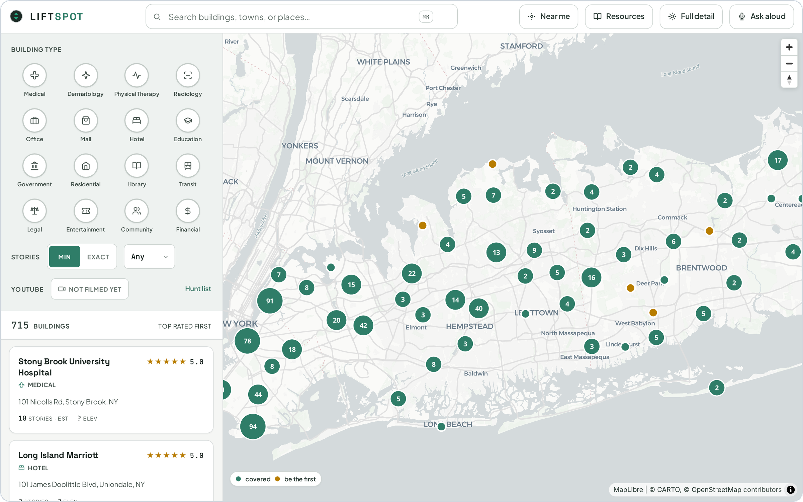
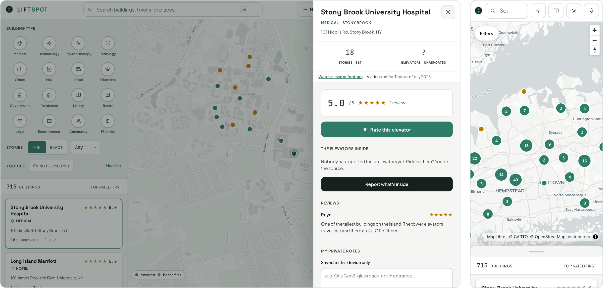
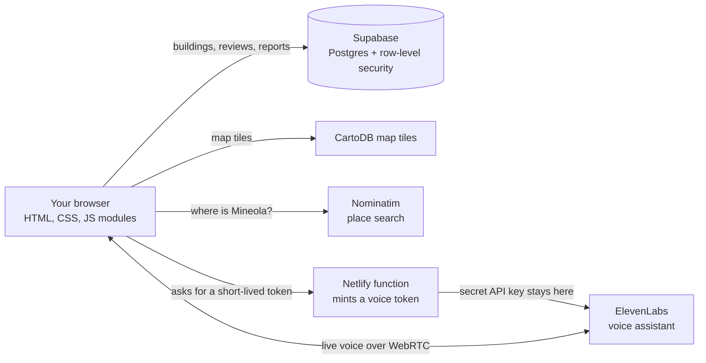
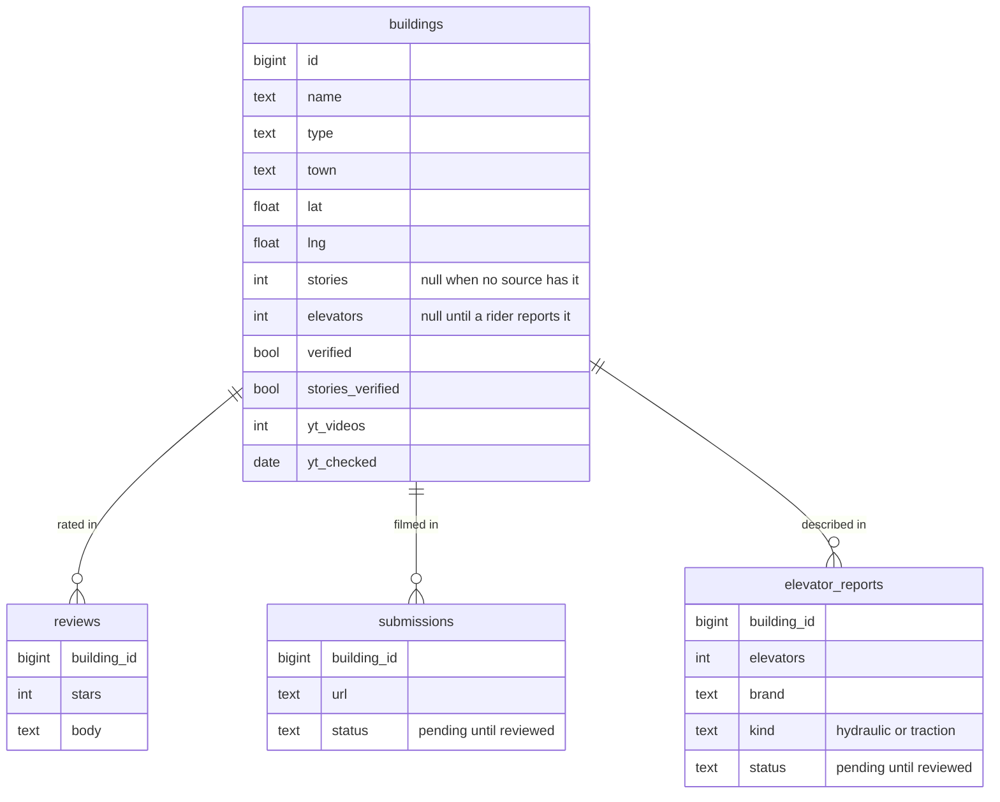
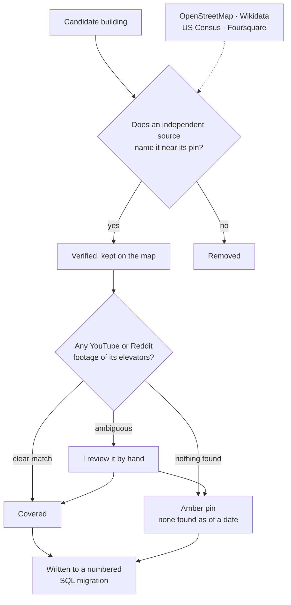
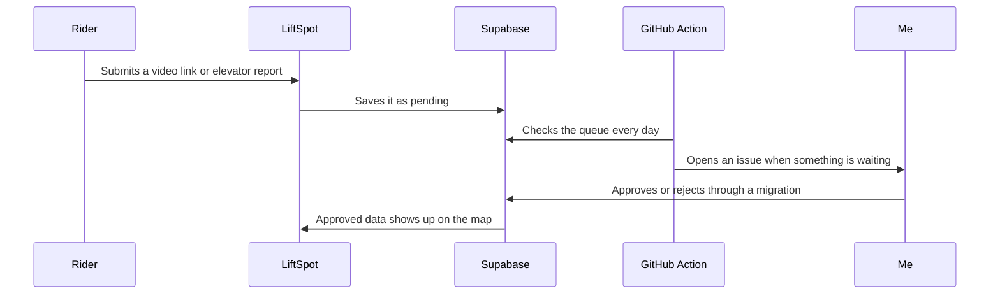

# LiftSpot

LiftSpot is a map of elevators across Long Island, Queens, and Brooklyn. It has 715 buildings you can search, filter, review, and help fill in, and it's live at [liftspot.netlify.app](https://liftspot.netlify.app).


## Why I made this

My younger brother has been obsessed with elevators for over a decade. He spends hours every day finding new buildings and riding every elevator he can, and he notices the things most people walk right past, like who made the cab, how fast it moves, and what the doors sound like when they close. He reviews them on [@elevatorzboy20](https://www.youtube.com/@elevatorzboy20) with more care than most critics I've read.

When I went looking for something that would help him figure out where to go next, I couldn't find anything. There was no map of buildings worth visiting, no way to filter by type or height, and nowhere to leave a review that other people could actually use, so I started building one for him, and it kept growing from there.

## What you can do with it

Every building is pinned on the map, and clicking a pin opens a drawer with the building's details, its reviews, and what's known about filming it. You can search by name, by town, or with a plain-English query like "5-story hospital in Mineola," and if the search matches a real place, the map switches to showing everything within a radius of it. You can also filter by building type and number of stories, or turn on near-me mode to sort everything by distance.

The feature my brother uses most is the amber pins. LiftSpot checks YouTube and Reddit for footage of each building's elevators, and buildings nobody has filmed yet show up in amber, so you can see at a glance where you'd be the first. There's also a [hunt list](https://liftspot.netlify.app/hunt.html) that groups those buildings by town or sorts them by distance, with a checklist you can print and take with you.

Ratings only come from real reviews, so a building nobody has reviewed just says "No reviews yet." If you ride an elevator, you can report how many there are along with the brand and drive type, and if you film one, you can submit the YouTube link. Both go into a review queue before they show up on the map. You can also keep private notes on any building, and those stay on your own device.

If you'd rather talk than type, the "Ask aloud" button opens a voice assistant you can ask about buildings in the catalog. It answers from the same data as the map and follows the same rules about what it knows and what it doesn't.





## Designing it to be calm

A lot of people who love elevators the way my brother does are autistic, and a map covered in pins, numbers, and badges can be a lot to take in. LiftSpot opens in a calm mode with a muted palette inspired by modern elevator cabs, very little motion, and only the essentials on screen, and there's a toggle for the full detail view whenever you want more.

Every state of the interface passes automated accessibility checks with axe, and animations turn off for anyone who has reduced motion set on their device. Dialogs trap focus properly, tap targets are big enough to hit on a phone, and on small screens the map comes first, with the building list in a sheet you can drag up. The voice assistant was set up with the same audience in mind, so it waits patiently for you to finish talking and answers in plain, literal language.

## How it fits together

The whole app runs in the browser and talks to a few services directly. The only server code is one small function that keeps the voice assistant's API key private.



### Why I picked each piece

| Layer | What I used | Why | What it costs me |
|-------|-------------|-----|------------------|
| Frontend | Plain HTML, CSS, and JavaScript modules | No framework or build step, so anyone can clone it and run it with one command | No components or type checking, which gets harder to manage as the app grows |
| Map | MapLibre GL with CartoDB tiles | Open source, fast with hundreds of pins, and pins render on the map canvas so they never drift | Styling pins as map layers is more work than placing HTML elements |
| Database | Supabase (Postgres) | A real database with row-level security, so the browser can talk to it without a backend of my own | The security rules have to be right, because nothing else stands between visitors and the data |
| Search | Nominatim (OpenStreetMap) | Free geocoding from the same open data I verify buildings against | It allows about one request per second, so search caches results and rate-limits itself |
| Voice | ElevenLabs + a Netlify function | Lets people ask about buildings out loud, which matters for accessibility | Needs the one piece of server code in the project, to keep the API key private |
| Data pipeline | Python scripts that write SQL migrations | Every change to the catalog is a numbered file I can read, review, and trace back to evidence | Running the pipeline is a manual step |
| Cleanup | [liftspot-data-tool](https://github.com/selinmutlu06/liftspot-data-tool) (C++) | Validates every row, finds each building's nearest neighbor with haversine distance, and clusters nearby buildings with union-find | A second repo to keep in sync |

### The data model



## Keeping the data trustworthy

The catalog started out as seeded data, which meant invented floor counts, guessed elevator counts, and a fake rating on every building. Most of the work on this project since then has gone into fixing that, with one rule behind every decision, which is that the app should never show a guess as if it were a fact.

Here's the path every building takes before it shows up on the map.



Every building on the map today has been confirmed to exist. I made that check strict on purpose, because a made-up "Elmont Medical Center" has a real-looking address and an optometrist next door, and a looser check would have let it through. The Queens and Brooklyn buildings were imported straight from OpenStreetMap, so they were confirmed from the start.

Floor counts only show as fact when OpenStreetMap backs them up, and everywhere else they're marked as estimates. There's no public source for how many elevators a building has, so I deleted every guessed count, and that number now only comes from riders who've been there. When a footage match was ambiguous, I reviewed it myself, which came out to 372 candidates across 96 buildings.

That strictness caught real mistakes along the way. All five videos the app had matched to Huntington Public Library turned out to be of South Huntington Public Library, so I added a check that treats a direction word before a name as a different building.

### How rider contributions get in

Nothing a visitor submits goes straight onto the map. It waits for me first.



## What I'd change next

Right now the app loads every building at once, which is fine at 715 but won't be at ten times that, so the next step is only fetching buildings inside the part of the map you're looking at. The rating is also stored on each building row and updated from the browser, and I want to move that calculation into the database so the browser never writes it at all.

## Running it locally

```bash
git clone https://github.com/selinmutlu06/liftspot.git
cd liftspot
python3 -m http.server 8000
```

Then open http://localhost:8000. The database allows public reads, so the map loads right away. The voice assistant needs an ElevenLabs key and `netlify dev`, and `.env.example` shows what to set.

## License

MIT

<sub>Made for one very specific critic. You can find him on [YouTube](https://www.youtube.com/@elevatorzboy20) and [Instagram](https://www.instagram.com/elevatorzboy20).</sub>
